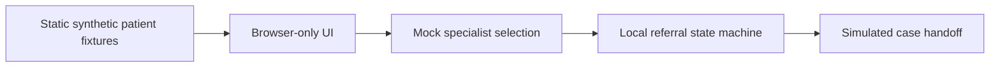
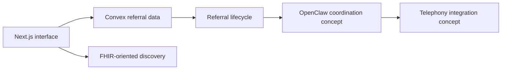

# ClawControl — AI-Assisted Emergency Referral Coordination

**MedHack 2026 · Team Hackathon Case Study · Offline Portfolio Demo**

[View source](https://github.com/a0981456759/clawcontrol-portfolio) · [Architecture](docs/ARCHITECTURE.md) · [My contributions](docs/MY_CONTRIBUTIONS.md) · [Security](docs/SECURITY.md) · [Interview talking points](docs/INTERVIEW_NOTES.md)

> **Scope:** This repository contains an independently reconstructed **static demonstration using synthetic data**. It does **not** contain the original team application, connect to FHIR, Convex, OpenClaw or Twilio, or perform clinical activities.

## The problem

Emergency-department specialist referrals can involve fragmented handoffs, finding an available specialist, and tracking who has acknowledged a case. ClawControl was a hackathon **prototype concept** investigating a coordinated workflow and AI-assisted handoff.

## What this repository actually demonstrates

| Implemented here | Original team prototype / conceptual integration |
| --- | --- |
| Three fictional patient scenarios | FHIR-oriented patient and specialist discovery |
| Locally simulated specialist availability | Convex data model and referral lifecycle |
| In-memory referral state transitions | Next.js frontend connected to backend workflows |
| Responsive static UI | OpenClaw-assisted coordination and telephony concepts |
| Offline tests and CI | **Not running** in this portfolio edition |

**No audio recording or transcription** is included or planned for this portfolio edition. The EWS figures are illustrative fixtures, not clinically validated scores.

## Demo walkthrough

1. Run `python3 -m http.server 8080` and open **http://localhost:8080**.
2. Select **Demo Patient Alpha** from the referral queue.
3. Choose **Cardiology** and select **Find mock specialist**.
4. Select **Advance demo workflow** to move through the simulated referral stages.
5. Use **Reset case** to restore the fixture.

All changes are local to the browser session; refreshing the page resets the demonstration.

### Demo UI

The repository intentionally avoids third-party screenshots and patient media. To capture an authentic screenshot, run the local demo above and save a screenshot of **your own synthetic-data UI**. See [Screenshot guide](docs/SCREENSHOTS.md). Do not substitute a conceptual design mockup for an actual running screenshot.

## Architecture

**Portfolio implementation (this public repository):**



**Original hackathon architecture (described, not running here):**



The second diagram summarizes the team's design and repository evidence, **not a claim of verified end-to-end operation**. See [detailed architecture](docs/ARCHITECTURE.md).

## My contributions to the original team project

The original private Git history contains commits attributed to **Chenhsuan Wang** associated with:

- Convex backend integration and patient-oriented data modeling.
- Referral lifecycle and state-management logic.
- FHIR-related specialist discovery and fallback paths.
- Frontend integration with backend referral data.

These are **team-project contributions**, not a claim that one person built the entire system. Ownership of OpenClaw, Twilio and recording integrations is **not attributed here** without further verification. See [contribution evidence and caveats](docs/MY_CONTRIBUTIONS.md).

## Engineering decisions and limitations

- **Why synthetic data?** The original materials include team-owned code and healthcare-themed research; republishing them risks licensing or confidentiality issues.
- **Why a static mock?** Recruiters can explore the flow without credentials, medical APIs, paid services or live phone calls.
- **Why separate architecture diagrams?** The publicly runnable implementation must not be mistaken for the original Next.js/Convex/OpenClaw system.
- **What isn't validated?** Authentication/authorization, clinical safety, real specialist availability, FHIR interoperability, Agent accuracy, telephony and production reliability.
- **Known demo simplification:** Its referral statuses live only in memory and are deterministic, not persisted or coordinated across users.

## Reproduce the checks

Requires Node.js 20+; no package installation is needed.

```bash
node --test
node --check src/app.js
node --check src/mock-data.js
python3 -m http.server 8080
```

GitHub Actions also runs automated mock-data tests and checks for accidentally tracked secret/media file types. Passing CI means the **mock demo checks pass**, not that the original clinical/AI integrations are safe or functional.

## Attribution & publication

Original ClawControl: a **MedHack 2026 team project** (original repository remains private). This public repository is a separate portfolio companion and does not reproduce original team source or materials. It does not grant any license to third-party/team materials. Please seek team agreement before republishing team content or using additional branded media.

**For educational and portfolio use only. Not medical advice, a clinical product, or an operational AI agent.**
